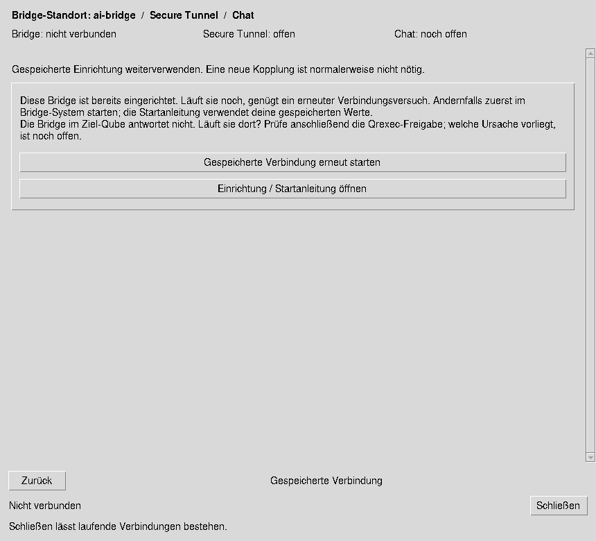
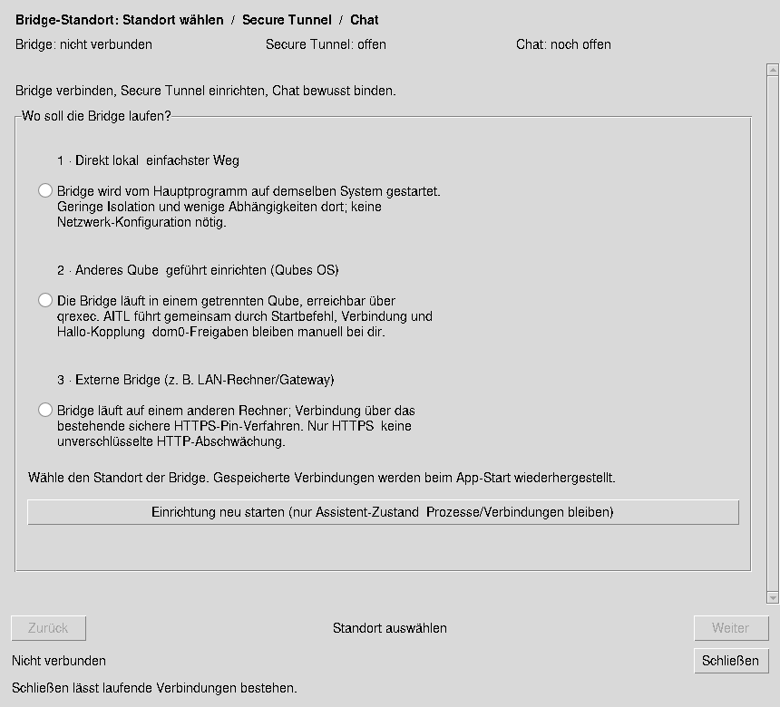
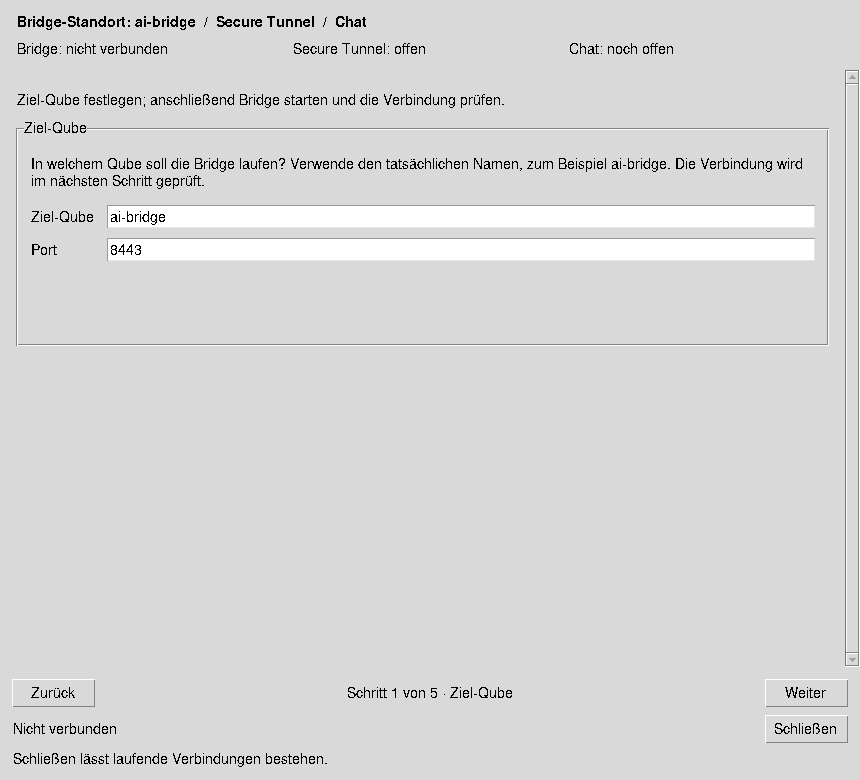
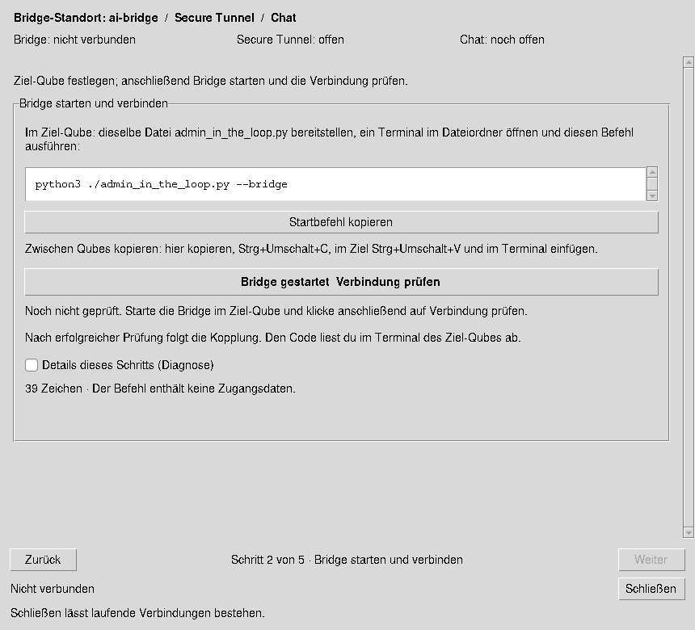
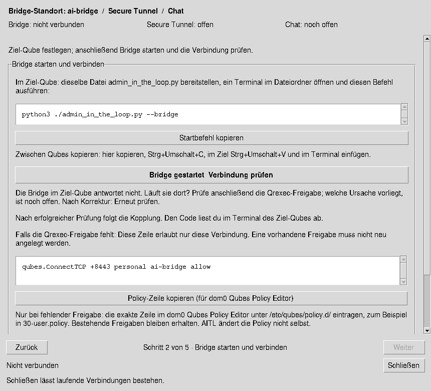
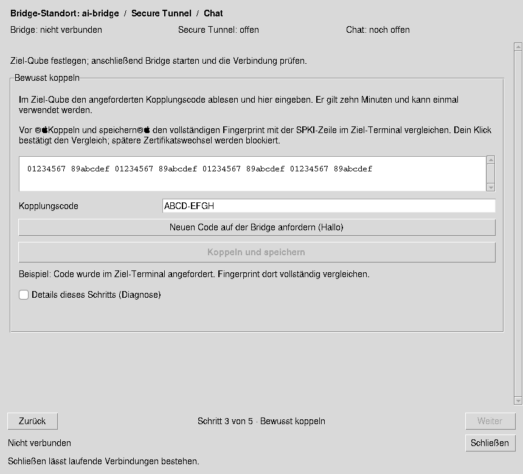
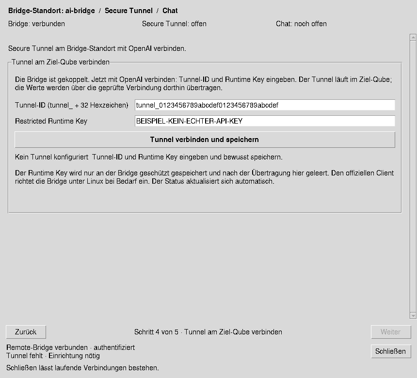
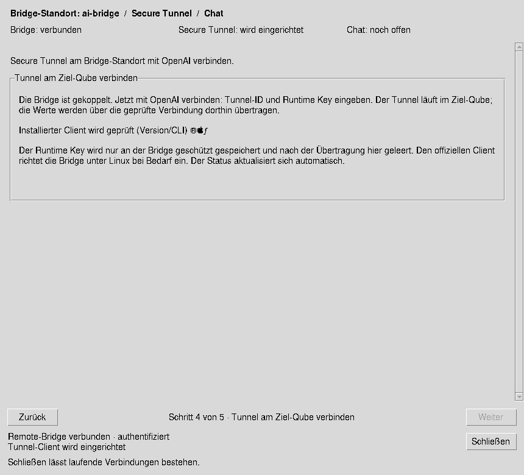
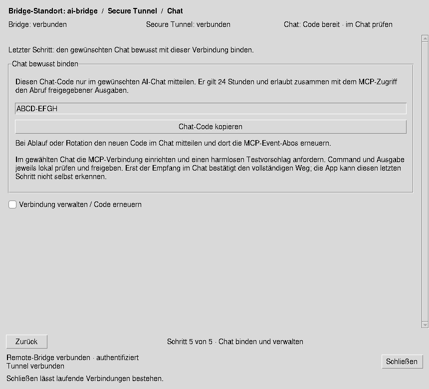
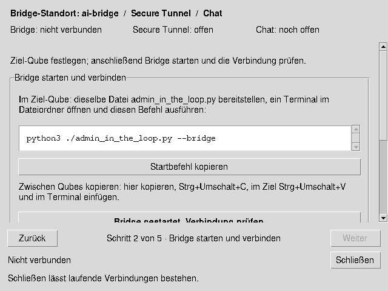

# Bridge, Secure Tunnel und AI-Chat verbinden

Entwicklungsstand 0.9.18. Das Fenster „AI / MCP — Verbindung einrichten“ trennt
drei Zustände: die authentifizierte Bridge-Verbindung, den OpenAI Secure MCP
Tunnel und die bewusst gewählte Chatbindung. Ein verbundener Tunnel beweist noch
keinen vollständigen Austausch mit dem AI-Chat.

## Was beim App-Start passiert

Eine gespeicherte Remote-Verbindung wird einmalig automatisch mit ihrem
bisherigen Zertifikats-Pin und Controller-Zugang wiederverbunden. Die Bridge
kann im anderen Qube oder auf einem Gateway bereits weiterlaufen. Die App
verwendet diese bestehende Einrichtung; sie fordert keinen neuen Kopplungscode
an und rotiert keinen Chat-Code. Die authentifizierte Verbindung prüft auch den
Tunnelstatus, ohne den Einrichtungsdialog öffnen zu müssen. Nach bestätigtem
Controller-Kontakt stößt die Bridge einen frischen Healthcheck ihres eigenen
Tunnel-Clients an. Gesunde Clients werden weiterverwendet; ein behebbar
ausgefallener Client wird mit der gespeicherten Konfiguration begrenzt neu gestartet.
Key-/Rechtefehler, ungeeignete Clients, Installationsfehler und Provider-Drosselung
verlangen weiterhin eine lokale Klärung statt einer Neustartschleife.

Die Statusbeobachtung läuft nach „verbunden“ weiter. Die Bridge prüft den
aktuellen Control-Plane-Healthstatus und akzeptiert einen erfolgreichen Kontakt
nur innerhalb der letzten 90 Sekunden (maximal 30 Sekunden Zukunftstoleranz für
Uhrabweichungen). GET-Statusabfragen allein starten nichts. Ein automatischer
Wiederanlauf erfolgt bei bestätigtem Controller-Kontakt, maximal einmal innerhalb
von 30 Sekunden. Nach einem Ausfall im laufenden Betrieb kann der Client zunächst
selbst wieder verbinden; bleibt das aus, zeigt die Anzeige den Fehler und die
gespeicherte Verbindung kann erneut gestartet werden. Ein verbundener Tunnel
bleibt vom tatsächlichen Laden der Werkzeuge im AI-Chat zu unterscheiden.

Für Qubes wird die eigene Qrexec-Weiterleitung im Hintergrund vorbereitet. Ein
fremder Listener wird weder übernommen noch beendet. Fehlende Werkzeuge,
Portkonflikte und Zertifikatswechsel werden als Fehler angezeigt. Ein bewusster
Verbindungsabbruch verhindert spätere Übernahme eines noch laufenden
Wiederherstellungsversuchs. Ein neuer Versuch benötigt dann eine Benutzeraktion;
die Netzwerkverbindung selbst besitzt weiterhin ihre bestehende Retry-Logik.

Für eine gespeicherte lokale Einrichtung werden die bereits geprüften
Tunnelwerte wiederverwendet und die eigene lokale Bridge sowie der Tunnel neu
vorbereitet. Die App übernimmt keine fremde, ungesichert identifizierte lokale
Bridge. Eine lokale Wiederherstellung gilt erst nach dem Tunneltest als erfolgreich.
Die bestehende Client-Prüfung und gegebenenfalls Installation bleiben wirksam.

Bei Problemen zeigt der Dialog zuerst zwei verständliche Optionen:
„Gespeicherte Verbindung erneut starten“ und „Einrichtung / Startanleitung öffnen“.
Für eine abgeschaltete externe Bridge führt die Anleitung zu ihrem bisherigen
Standort und Startbefehl. Die App startet die Bridge im fremden Qube nicht
automatisch und ändert keine dom0-Policy. Eine bereits laufende Bridge verwaltet
ihren eigenen Tunnel-Client. Dafür ab v0.9.18 auch die Bridge aktualisieren und
mit unverändertem State-Verzeichnis neu starten.

## Beispiel: personal → ai-bridge → OpenAI → Chat

**Herkunft der Bilder:** Diese Screenshots wurden aus den aktuellen Tk-Widgets
der Anwendung unter Linux gerendert. Qubes-Erkennung, Bridge-/Tunnelzustände,
Fingerprint, Codes und Zugangsfelder sind ausdrücklich kontrollierte
Beispieldaten. Es wurde keine Qubes-Verbindung, kein externer Tunnel und keine
Kopplung ausgeführt. Dies ist eine Ansicht der implementierten Oberfläche,
kein Nachweis eines nativen Qubes- oder Live-OpenAI-Tests. Die gesonderten
Integrationstests prüfen die automatische Wiederverbindung mit einer echten
lokalen TLS-Bridge und unverändertem Pin.

### Standort auswählen

„Anderes Qube“ erscheint nur auf einem erkannten Qubes-System. Lokal und eine
externe HTTPS-Bridge bleiben eigenständige Wege. Auf einem bereits eingerichteten
System beginnt der Dialog stattdessen bei Wiederherstellung oder aktuellem Status.

### 1. Ziel-Qube festlegen

Beispiel: `ai-bridge`, Port `8443`. Der Name wird syntaktisch geprüft; die App
behauptet an dieser Stelle noch keine nachgewiesene Erreichbarkeit. Ein anderer
Port wird auch im angezeigten Startbefehl berücksichtigt.

### 2. Bridge starten und Verbindung prüfen

Dieselbe Python-Datei im Ziel-Qube bereitstellen. Im Dateiordner startet
`python3 ./admin_in_the_loop.py --bridge` die Bridge. Der Befehl lässt sich direkt
kopieren; die Oberfläche erklärt den Qubes-Clipboard-Weg. „Bridge gestartet –
Verbindung prüfen“ prüft die Weiterleitung und fordert bei einem noch nicht
gekoppelten Ziel bewusst den dortigen Code an. Die Navigation allein löst keine
Kopplung oder Initialisierung aus.

Falls die Verbindung scheitert, bleibt dieser Schritt sichtbar. Die Hilfe zeigt
nur die konkrete, eng begrenzte Policy-Zeile für `personal` → `ai-bridge`.
Eine fehlende Freigabe wird als mögliche Ursache benannt; ein gestoppter
Bridge-Prozess kann denselben Verbindungsfehler verursachen. Technische
Versuchsdiagnosen sind separat aufklappbar.

### 3. Bewusst koppeln

Den vollständigen SPKI-Fingerprint mit der Bridge-Konsole im Ziel-Qube vergleichen.
Den dortigen einmaligen Code eingeben und „Koppeln und speichern“ wählen.
Gespeichert wird genau dieser Pin. Eine bereits bestehende eigene Kopplung kann
mit passenden gespeicherten Zugangsdaten wiederverwendet werden.

### 4. Secure Tunnel am Bridge-Standort einrichten

Tunnel-ID und Restricted Runtime API key aus der richtigen OpenAI-Organisation
verwenden. Key und Benutzer benötigen Tunnels Read + Use. Die Werte werden
über die gepinnte Verbindung an die Bridge übertragen; dort laufen Client und
Tunnel. Ein bereits funktionsfähiger Tunnel überspringt diese Eingabe.

Während der Vorbereitung zeigt die Seite den beobachteten Fortschritt. Sie
wechselt nach bestätigter Tunnelverbindung zum Chat-Schritt. Der Runtime Key
wird nach beantworteter Übertragung aus den Eingabefeldern gelöscht.

### 5. Gewählten Chat binden und den vollständigen Weg prüfen

Den aktuellen Chat-Code kopieren und nur dem gewünschten AI-Chat mitteilen.
Die App rotiert den Code nicht allein durch Öffnen dieser Seite. Verwaltung,
Trennen und bewusste Code-Erneuerung liegen unter „Verbindung verwalten / Code
erneuern“. Ein harmloser Vorschlag mit getrennt freigegebener Terminalausgabe
und bestätigtem Empfang im Chat prüft den vollständigen Weg.

## Kleine Fenster und weitere Dienste

Zurück, Fortschritt und Schließen bleiben außerhalb der scrollbaren Seite.
Die Oberfläche wurde bei 640×480 und 860×780 geprüft. „Weiter“ ist von den
jeweiligen Verbindungsbelegen abhängig; Zurück erhält Eingaben und startet nichts.

Für spätere externe Prüfdienste gilt dasselbe Bedienprinzip: gespeicherte
Konfiguration, gerade laufende Initialisierung, nachgewiesene Bereitschaft und
nötige erneute Anmeldung sind verschiedene Zustände. Die vorhandenen lokalen
Prüfdienste nutzen ihren Einstellungsreiter. Ein zusätzlicher externer Dienst
oder eine neue automatische Anmeldung wurde hier nicht eingeführt.

## Reproduzieren

Die Bilder erzeugt `tests/render_connection_dialog.py` unter einem kontrollierten
Tk-Display mit Pillow. Ein optionales erstes Argument setzt das Ausgabeverzeichnis.
Die Tests `test_connection_recovery.py` und `test_connection_dialog_ux.py` prüfen
Wiederherstellung, Pinwechsel, Abbruch während Qrexec-Vorbereitung, Trennung der
Statusanzeigen, individuelle Ports und Navigation bei kleinen Fenstern.

## Prüfnachweis dieses Stands

Bestanden: 8 gezielte Wiederherstellungstests, 4 neue Dialog-UX-Tests,
42 bestehende GUI-Tests, 15 sh-guard-UX-Regressionen und 49 Selbsttests.
Der zusätzliche Einrichtungs-/TLS-/Qrexec-Lauf umfasst 58 Tests: 56 bestanden,
2 explizit übersprungen (offizielles Tunnelbinary nicht bereitgestellt;
realer ChatGPT-Work-Host/Workspace hier nicht verfügbar).
Die Wiedereinbindung einer bereits laufenden Remote-Bridge wurde mit echtem
lokalen TLS, gespeicherten Zugangsdaten und unverändertem Zertifikats-Pin geprüft;
auch ein abweichender Pin wurde blockiert. Eine bestehende eigene Qrexec-
Weiterleitung wird beim erneuten Verbindungsversuch wiederverwendet. Ein
Einstellungs-Reload während der Vorbereitung ändert das Ziel dieses Versuchs nicht.
Native Qubes-Ausführung und ein Live-OpenAI-/ChatGPT-Rundlauf sind durch diese
Prüfungen nicht nachgewiesen. `git diff --check` meldet keine Fehler.
