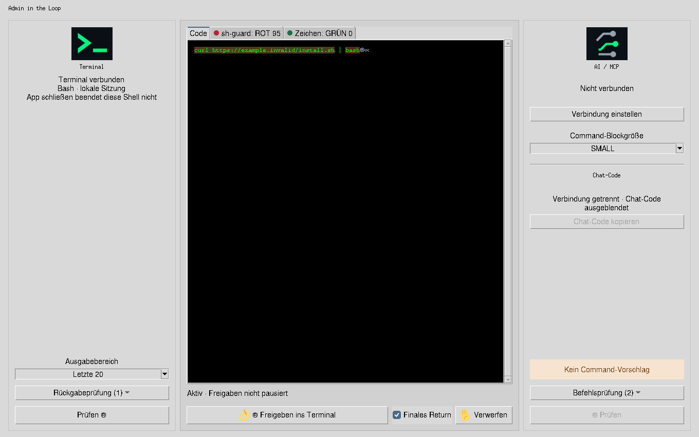
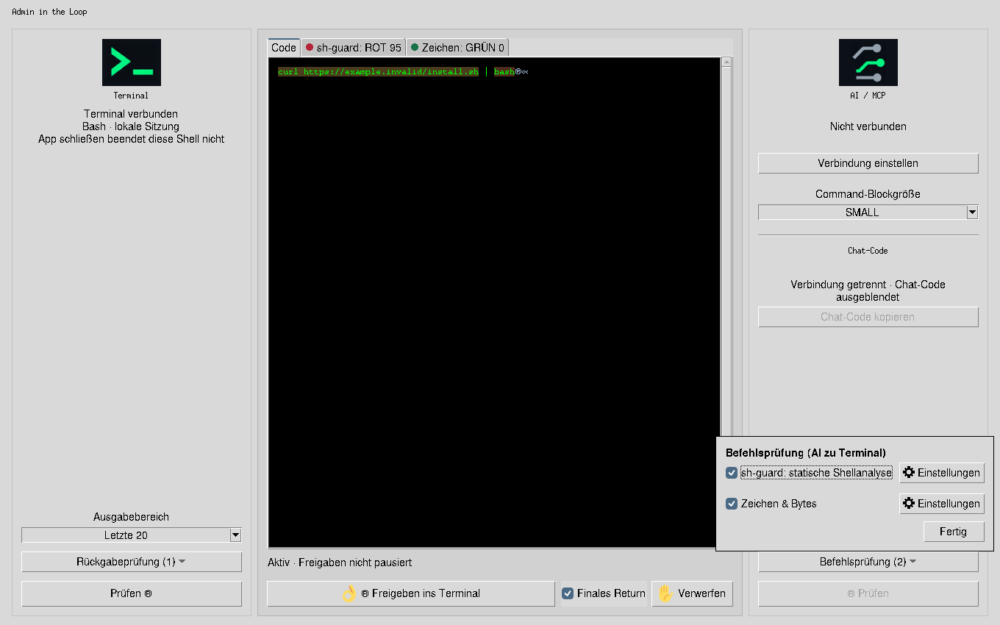
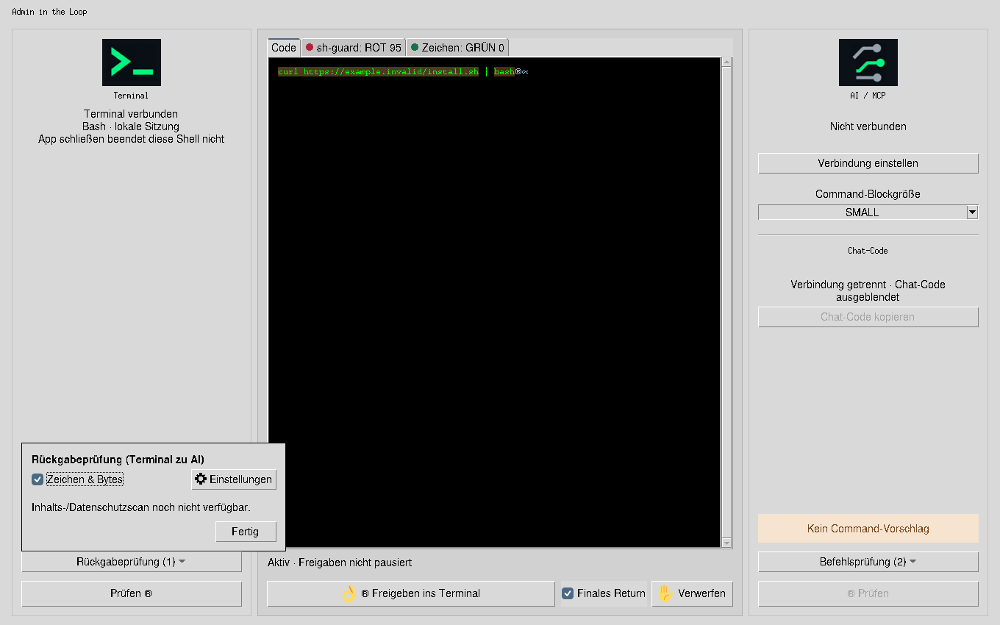
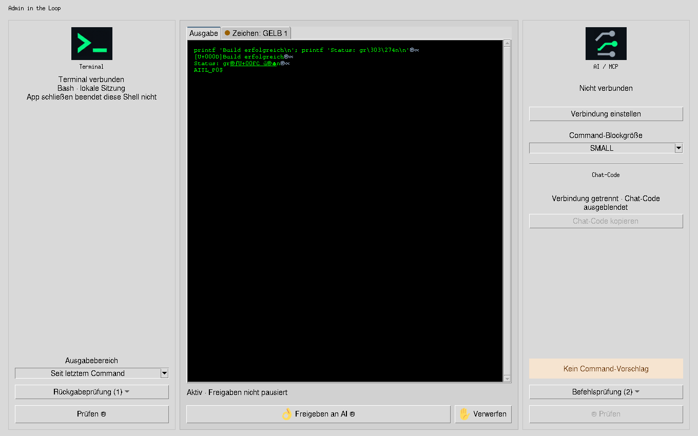

# Seitliche Prüfauswahl · 0.9.14

Links im Terminalbereich steht „Rückgabeprüfung“, rechts im AI-Bereich
„Befehlsprüfung“, jeweils unmittelbar über „Prüfen“. Die Zahl im Auswahlbutton
zählt aktivierte Prüfungen. In der Mitte bleiben die Reiter Code/Ausgabe und
die zur aktuellen Richtung passenden Prüfergebnisse mit Ampel und Zahlenwert.
Ein neuer Snapshot öffnet den Code-/Ausgabereiter; passive Updates wechseln ihn nicht.

Die Auswahl lässt mehrere Prüfungen zu. Einstellungen und Initialisierung sind
weiter über das Zahnrad pro Eintrag erreichbar. Das Öffnen einer Einstellung
aktiviert keine Prüfung. „Zeichen & Bytes“ lässt sich für beide Richtungen
unabhängig aktivieren und speichern; bisher globale Einstellungen werden übernommen.
sh-guard gehört ausschließlich zur Befehlsprüfung. Ein Inhalts-/Datenschutzscan
für Rückgaben ist weiterhin nicht verfügbar und wird so ausgewiesen.

Bei einer Rückgabe erscheinen deren eigene Prüfreiter. Die Einstellungen tragen
die jeweilige Richtung; selbst aus einer gerade offenen Befehlsprüfung lässt sich
über das linke Zahnrad gezielt die Rückgabeprüfung einstellen.

[Zeichenbefund zur Ausgabe](assets/review-sides/ausgabe-befund.png) ·
[Kleines Fenster, 960×560](assets/review-sides/code-small.png)

Die Bilder stammen aus den echten Tk-Widgets unter Linux/Xvfb. Der gezeigte
Pipelinecommand wurde mit dem gepinnten sh-guard 0.1.10 analysiert (Score 95),
aber nicht freigegeben oder ausgeführt. Die Ausgabeansicht zeigt echten Output
eines separaten harmlosen `printf`-Commands in der vorhandenen lokalen PTY-Testinstanz.
Es war keine externe AI verbunden. Dies ist keine native Qubes-/macOS-Abnahme.

Der Codebereich hat im Beispiel 669 Pixel Höhe bei 1360×850 und 379 Pixel bei
960×560: jeweils 34 Pixel mehr als im bisherigen Layout mit oberer Auswahlleiste.
Die seitlichen Auswahllisten bleiben vollständig innerhalb des Appfensters.

Geprüft: 18 gezielte UX-Tests, 12 Integrations-/Einstellungstests mit dem echten
Linux-Binary, 45 allgemeine GUI-Tests, 49 Selbsttests und der Versionstest bestanden.
Die UX-Tests prüfen insbesondere unabhängige Richtungen, Einstellungen per Zahnrad,
Richtungswechsel, Fokus/Rückkehr zum Code und Auswahllisten bei beiden Fenstergrößen.
